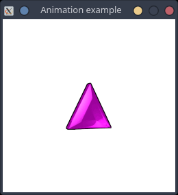
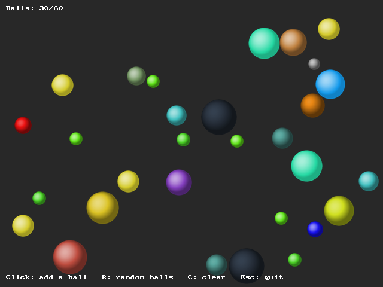
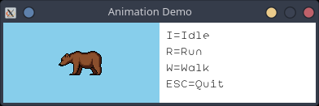
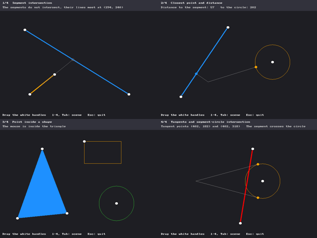
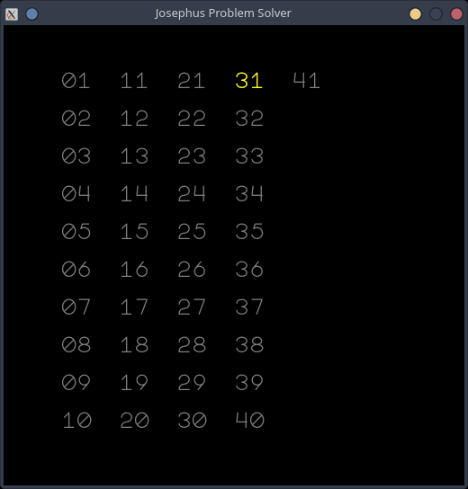
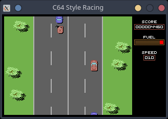

# SwinGame Pascal examples

Pascal examples for the [SwinGame library](https://github.com/macite/swingame).

## Requirements

* [Free Pascal](https://www.freepascal.org/) 3.2
* Clang
* SDL2, SDL2_mixer, SDL2_image, SDL2_gfx, SDL2_ttf, SDL2_net
* libpng, libcurl

On Debian or Ubuntu:

```bash
sudo apt install fpc clang libsdl2-dev libsdl2-mixer-dev libsdl2-image-dev libsdl2-gfx-dev libsdl2-ttf-dev libsdl2-net-dev libpng-dev libcurl4-openssl-dev
```

## Clone this repository and build the library

```bash
git clone https://github.com/rchastain2/swingame-pascal-examples.git
cd swingame-pascal-examples
bash build-library.sh
```

## Build and run an example

```bash
cd amethyst
make
./demo
```

## Contents

### Amethyst

Simple animation example.



### Balls

Bouncing balls with elastic collisions.



### Bear

Another animation example.



### Geometry

Interactive demonstrations of the geometry functions.



### Josephus

Resolution of the Josephus problem.



### Racing

C64 style racing game.


