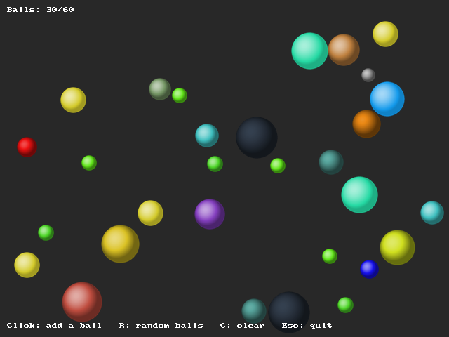

# Balls

Bouncing balls example: sprites, velocity, mass and elastic collisions between circles.

## Controls

* Click: add a ball
* R: add random balls
* C: remove all balls
* Esc: quit

## Credits

* [Colored Spheres][1] by [athile][2] (CC0)

[1]: https://opengameart.org/content/colored-spheres
[2]: https://opengameart.org/users/athile
