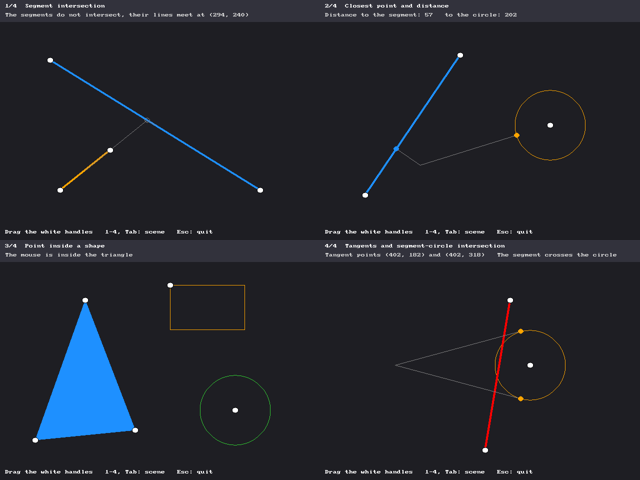

# Geometry

Interactive demonstrations of the SwinGame geometry functions.

## Scenes

1. Segment intersection: `LineIntersectionPoint`, `LineSegmentsIntersect`
2. Closest point and distance: `ClosestPointOnLine`, `ClosestPointOnCircle`, `PointLineDistance`
3. Point inside a shape: `PointInTriangle`, `PointInRect`, `PointInCircle`
4. Tangents and segment-circle intersection: `TangentPoints`, `LineIntersectsCircle`

## Controls

* Drag the white handles to move the shapes
* Move the mouse in scenes 2, 3 and 4
* 1-4, Tab: change scene
* Esc: quit
